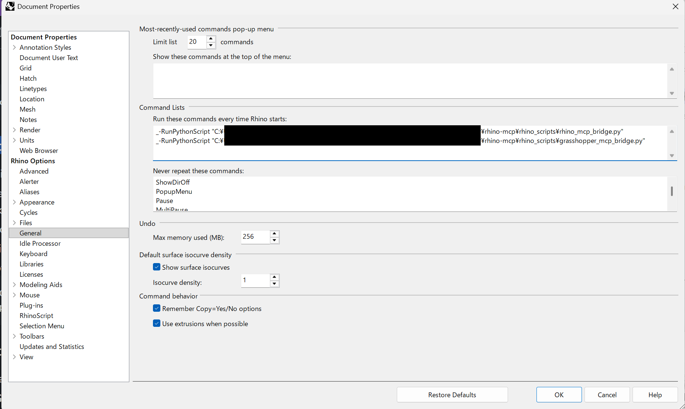

# RhinoMCP - Rhino Model Context Protocol Integration

**[ English ](README.md)**

RhinoMCP は、Model Context Protocol (MCP) を通じて Rhino、Grasshopper などを AI エージェントに接続し、AI が Rhino + Grasshopper を直接操作および制御できるようにします。Replicate.com の API キーを提供すれば、AI 画像レンダリングも可能です。この統合により、プロンプト支援型の3Dモデリング、シーン作成、および操作が可能になります。(inspired by [blender_mcp](https://github.com/ahujasid/blender-mcp))

## 機能

### 🦏 Rhino の機能
- `get_scene_info`: シーンの概要とレイヤーを取得します。
- `capture_viewport`: ビューポートを画像としてキャプチャします。
- `execute_rhino_code`: Python コードを実行してオブジェクトを作成・変更します。
- **[すべての Rhino ツールを見る](FEATURES_JP.md#rhino-mcp-ツール)**

### 🦗 Grasshopper の機能
- `get_gh_context`: コンポーネントグラフ全体を探索します。
- `update_script`: コンポーネントのコードをリアルタイムで変更します。
- `bake_objects`: ジオメトリを Rhino に転送します。
- **[すべての Grasshopper ツールを見る](FEATURES_JP.md#grasshopper-mcp-ツール)**

### 🤖 Replicate 統合
- **AI レンダリング**: Replicate API を通じて Stable Diffusion モデルを使用し、高品質なレンダリングを生成します。

## プロジェクト構造

このプロジェクトは標準的な `src` レイアウトに従っています：

- `src/rhino_mcp/`: **MCP サーバーコード** (Python 3.x)。MCP プロトコルを実装し、Rhino/Grasshopper と通信します。
- `rhino_scripts/`: **ブリッジスクリプト** (IronPython 2.7)。コマンドを処理するために Rhino および Grasshopper 内部で実行されるスクリプトです。
  - `rhino_mcp_bridge.py`: Rhino 統合用
  - `grasshopper_mcp_bridge.py`: Grasshopper 統合用

## インストール

### 前提条件

- Rhino 7 以降（Rhino 7 の初期の版 7.1 でも動作を確認しています。更新は必須ではありません）
- Python 3.10〜3.13（`uv` を使う場合は、`.python-version` に従って Python 3.12 が自動で入ります）
- `uv` (推奨) または `pip`

### Python 環境のセットアップ

依存関係の管理には、高速で信頼性の高い `uv` の使用を推奨します。

1. このリポジトリをクローンします。Windows では、特にこだわりがなければ、配置先に `%USERPROFILE%\InstalledModules\rhino-mcp` を推奨します。

2. 仮想環境を作成し、依存関係をインストールします：
   ```bash
   # 仮想環境の作成
   python -m venv .venv
   
   # 環境のアクティベート (Windows)
   .venv\Scripts\activate
   # 環境のアクティベート (Mac/Linux)
   source .venv/bin/activate
   
   # 編集可能モードでパッケージをインストール
   pip install -e .
   ```
   
   または `uv` を直接使用する場合：
   ```bash
   uv sync
   ```

   **Windows で AI アプリ（Claude デスクトップアプリなど）にセットアップさせる場合**は、Python の置き場所を AppData の外に指定してから `uv sync` してください。Claude デスクトップアプリは AppData への書き込みを別の場所に振り分けるため、指定しないと `Missing expected target directory for Python minor version link` というエラーで止まります。
   ```powershell
   $env:UV_PYTHON_INSTALL_DIR = "$env:USERPROFILE\.uv-python"
   uv sync
   ```
   この場合は、後述の MCP 登録にも同じ `UV_PYTHON_INSTALL_DIR` を指定してください。

   ダウンロードで `invalid peer certificate: UnknownIssuer` と出る場合（会社のセキュリティソフトなど）は、`uv sync --system-certs` で Windows 標準の証明書を使ってください。

### Rhinoアプリ起動時にMCPブリッジ自動起動させる

Rhino を起動するたびにスクリプトを手動で実行する手間を省くために、以下の手順で自動起動を設定できます：

1. Rhino を開きます。
2. **Tools**（ツール）→ **Options**（オプション）→ **General**（全般）に移動します（または **ファイル**→**プロパティ**→**全般**からもアクセス可能）。
3. **Command Lists**（コマンドリスト）の **Run these commands every time Rhino starts:**（Rhinoを開始するたびにこれらのコマンドを実行する）ボックスに以下を追加します。 `C:\path\to\rhino-mcp` の部分を、実際のプロジェクトフォルダの絶対パスに置き換えてください：
   ANSI/ISO キーボードの場合
   ```
   _-RunPythonScript "C:\path\to\rhino-mcp\rhino_scripts\rhino_mcp_bridge.py"
   _-RunPythonScript "C:\path\to\rhino-mcp\rhino_scripts\grasshopper_mcp_bridge.py"
   ```

   JIS キーボードの場合
   ```
   _-RunPythonScript "C:¥path¥to¥rhino-mcp¥rhino_scripts¥rhino_mcp_bridge.py"
   _-RunPythonScript "C:¥path¥to¥rhino-mcp¥rhino_scripts¥grasshopper_mcp_bridge.py"
   ```
4. **OK** をクリックし、Rhino を再起動します。



- AI にセットアップさせる場合も、この欄は**この画面に貼り付ける方法**で設定してください。Rhino 7 の初期の版には、スクリプトからこの欄を書き換える仕組みがありません。
- ブリッジは何度実行しても二重には起動しません（起動済みなら「既に起動しています」と表示されるだけです）。
- Grasshopper ブリッジを止めたいときは `rhino_scripts\grasshopper_mcp_bridge_stop.py` を実行してください。

## 設定

### Claude Code 統合（Claude デスクトップアプリの Code タブを含む）

次のコマンド1行で、どのフォルダーからでも使える形で登録できます（既存の MCP 登録は消えません）。`C:\path\to\rhino-mcp` は実際の配置先に置き換えてください。

```powershell
claude mcp add --scope user rhino -e UV_PYTHON_INSTALL_DIR=$env:USERPROFILE\.uv-python -- uv run --directory C:\path\to\rhino-mcp -m rhino_mcp.server
```

- 名前（`rhino`）は `-e` より前に書いてください。逆にすると `Invalid environment variable format` で失敗します。
- `UV_PYTHON_INSTALL_DIR` は、上の「AI アプリにセットアップさせる場合」の指定で `uv sync` したときに必要です。
- 登録できたかは `claude mcp get rhino` で確認できます。登録後に開いた新しいチャットから使えます（アプリの再起動は不要です）。

### Claude Desktop 統合

1. Claude Desktop > Settings > Developer > Edit Config に移動します。
2. `claude_desktop_config.json` ファイルを開き、以下の設定を追加します：

**Windows (例):**
```json
{
    "mcpServers": {
        "rhino": {
            "command": "uv",
            "args": [
                "run",
                "--directory",
                "C:\\path\\to\\rhino-mcp",
                "-m",
                "rhino_mcp.server"
            ]
        }
    }
}
```

**Mac/Linux (例):**
```json
{
    "mcpServers": {
        "rhino": {
            "command": "uv",
            "args": [
                "run",
                "--directory",
                "/path/to/rhino-mcp",
                "-m",
                "rhino_mcp.server"
            ]
        }
    }
}
```

### ChatGPT デスクトップ / Codex 統合

ローカル MCP に対応した ChatGPT デスクトップ／Codex では、`~/.codex/config.toml`（Windows: `%USERPROFILE%\.codex\config.toml`）に以下を追加します。ブラウザー版 ChatGPT には適用されません。

```toml
[mcp_servers.rhino]
command = "uv"
args = [
    "run",
    "--directory",
    'C:\path\to\rhino-mcp',
    "-m",
    "rhino_mcp.server"
]
```

パスを実際のクローン先に置き換え、保存後にアプリ／Codex を再起動してください。この1つの設定で Rhino・Grasshopper の両方に接続できます。Rhino 側のブリッジ起動は上記の手順と共通です。

参考: [OpenAI 公式 MCP 設定ドキュメント](https://learn.chatgpt.com/docs/extend/mcp?surface=cli)

### Cursor IDE 統合

1. `~/.cursor/mcp.json`（またはプロジェクト固有の `.cursor/mcp.json`）を見つけるか作成します。
2. 上記と同じ設定を追加します。

## 使用方法

設定が完了すると、Claude Desktop や Cursor を開いたときに MCP サーバーが自動的に起動します。
ツールを使用する前に、**Rhino/Grasshopper ブリッジスクリプト**が Rhino で実行されていることを確認してください。

### プロンプト例

- "Get information about the current Rhino scene" (現在の Rhino シーンに関する情報を取得して)
- "Create a cube at the origin" (原点に立方体を作成して)
- "Grasshopperでシンプルなパラメトリックタワーを作って"

## トラブルシューティング

- **接続の問題**: 
  - Rhino スクリプトが実行されていることを確認してください（Python Editor の出力を確認）。
  - ポート 9876 (Rhino) または 9999 (Grasshopper) が他のアプリケーションによって使用されていないことを確認してください。
- **パスエラー**:
  - `claude_desktop_config.json` が正しいプロジェクトルートディレクトリ（`pyproject.toml` がある場所）を指していることを確認してください。
- **`uv sync` が `Missing expected target directory for Python minor version link` で止まる**:
  - AI アプリの中から実行したときに起こります。「Python 環境のセットアップ」の `UV_PYTHON_INSTALL_DIR` の指定をしてから、もう一度実行してください。
- **Rhino を開き直したらつながらなくなった**:
  - 「Rhinoアプリ起動時にMCPブリッジ自動起動させる」の設定が入っているか確認してください。入っていない場合は、Rhino を起動するたびにブリッジのスクリプトを実行する必要があります。
- **AI からの操作がいつまでも終わらない／時間切れ（timed out）になる**:
  - Rhino でオプションやドキュメントのプロパティなどの設定画面が開いていると、その画面を閉じるまで Rhino は外からの操作を待たせます。設定画面を閉じてから、もう一度実行してください。

## ライセンス

このプロジェクトはオープンソースであり、MIT ライセンスの下で利用可能です。

